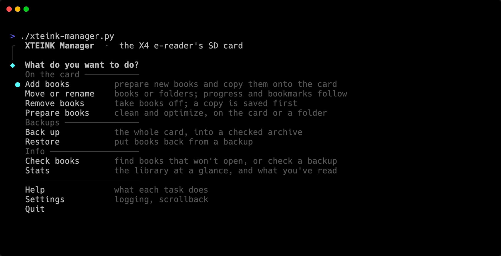

# xteink-manager

Keeps the SD card in an XTEINK X4 e-reader organized, prepares books for its screen, and backs the card up.




## Why

The X4 keeps its whole library on a microSD card, and it's fussy about that card:

- It remembers your place in each book by the book's file path. Move or rename a book in Finder, and the X4 forgets where you were.
- Books made for big color screens carry large images and embedded fonts, which slow the X4 down.
- Books that archive.org makes from page scans read badly: run-on paragraphs, with page numbers and running headers in mid-sentence.

So this script manages the card. It files new books by genre and author, prepares them for the X4's screen, carries your reading progress along when books move, and backs up the whole card. It explains itself as it goes, and asks before it changes anything.

It's made for an X4 running [CrossPoint](https://github.com/crosspoint-reader/crosspoint-reader), the open-source replacement firmware.


## What it does

- **Add books**: prepares new books and copies them onto the card, named from their own title and author, like `[ Classics ]/Austen, Jane/Emma.epub`.
- **Move or rename**: moves or renames books and folders. Reading progress and bookmarks follow.
- **Remove books**: takes books off the card, and saves a copy of each first.
- **Prepare books**: optimizes books the way CrossPoint's "Optimize EPUB" does, and repairs books made from archive.org page scans.
- **Back up**: saves the whole card as one archive with checksums, reads it back to check every file, then adds repair data.
- **Restore**: puts books back from a backup, checking each one first.
- **Check books**: finds books that won't open, or checks a backup.
- **Stats**: shows the library at a glance, and what you've read.

[More screenshots](screenshots/)


## Install

You'll need macOS (Linux works too) and [uv](https://docs.astral.sh/uv/).

```bash
brew install uv par2
git clone https://github.com/epohs/xteink-manager.git
cd xteink-manager
./xteink-manager.py
```

The first run fetches Python 3.14 or newer and everything else it needs. par2 is optional: it adds repair data to backups.

To run it from anywhere as `xteink-manager`:

```bash
mkdir -p ~/.local/bin
printf '#!/bin/sh\nexec "%s/xteink-manager.py" "$@"\n' "$PWD" > ~/.local/bin/xteink-manager
chmod +x ~/.local/bin/xteink-manager
```

If `xteink-manager` isn't found afterwards, run `uv tool update-shell` and open a new terminal.


## Usage

Run it with no options for the menu, then answer the questions. Or jump straight to one task:

```bash
./xteink-manager.py                  # the menu
./xteink-manager.py --add            # just one task
./xteink-manager.py --add ~/Books    # one task, with the books to add
./xteink-manager.py --help           # every option
```

Move, rename and remove books with the script, not in Finder, so the X4 keeps your place in them.

The [manual](MANUAL.md) covers every option and every task in the menu.


## License

[GPL-3.0-or-later](LICENSE). Use it, change it, share it. If you share a changed version, share its source under the same license.
