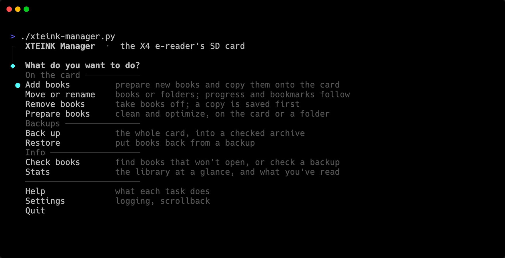
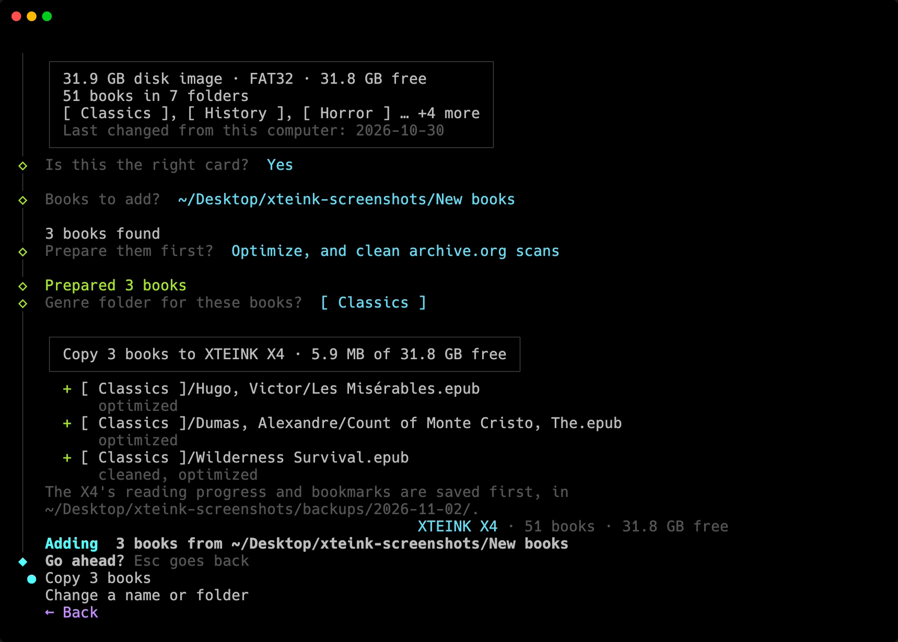
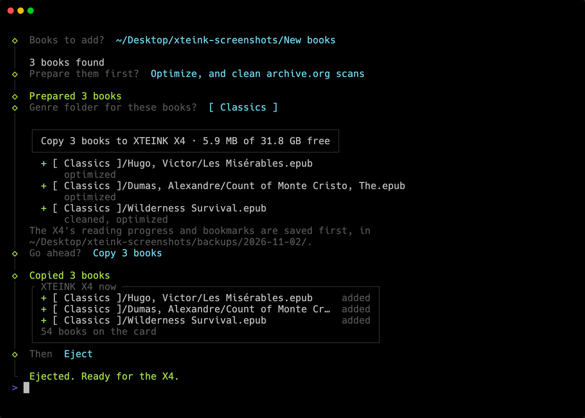
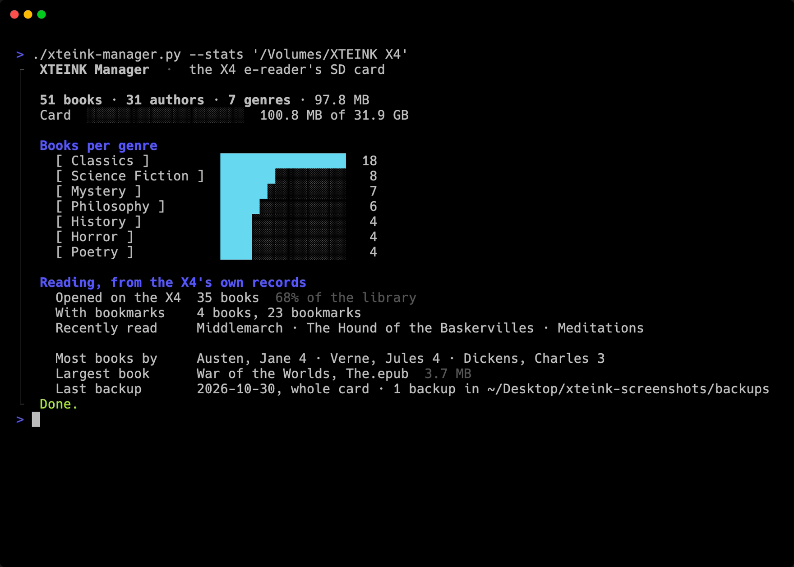

# Screenshots

| Screenshot | What it shows |
|---|---|
|  | **The menu.** Every task, grouped by what it does |
|  | **Adding books.** Before anything is copied, the script shows the plan: where each book goes on the card, and what was done to prepare it. One of these books was made from archive.org page scans, so it was cleaned as well as optimized |
|  | **What changed.** Once the books are copied, a box lists what's new on the card and how many books it holds now. Then the card is ejected |
|  | **Stats.** The library at a glance: books per genre, how full the card is, what's been read on the X4, and the last backup |

The books in these screenshots are public-domain titles on a test card, not a real library.
